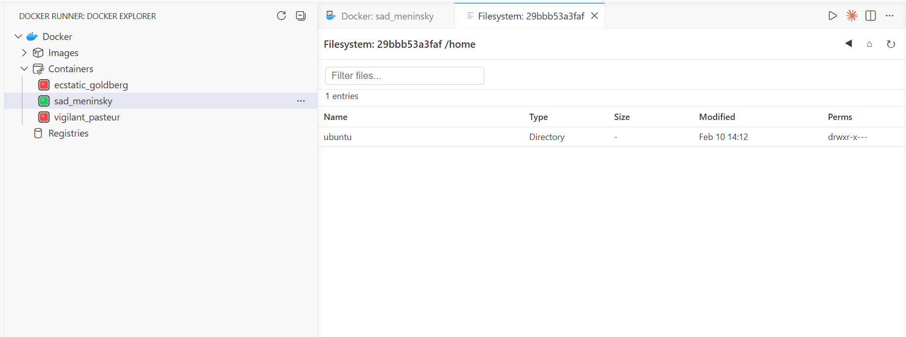

# Docker Runner

Manage Docker containers and images directly from VS Code — side by side with your code.



## Features

### 📦 Image Browser
- Browse local images in a sidebar tree or a full table view
- Inspect image details (history, config, environment)
- Pull, push, save, and delete images
- **Generate Dockerfiles** from existing images — reconstruct a Dockerfile from an image's history and inspect data

### 🚢 Container Manager
- List all containers (running + stopped) in tree or table view
- Start, stop, restart, pause, and unpause containers
- **Detail view** with tabs: Summary, Inspect (raw JSON), Ports, Environment, Mounts, History
- **History tab** shows:
  - Recent logs (`docker logs --tail 50`)
  - Filesystem changes (`docker diff`)
  - Shell command history from inside the container
- Attach terminal, execute commands, commit changes to new images
- **Create Dockerfile from Changes** — snapshots a container, extracts its configuration, and generates a Dockerfile

### 📁 Container Filesystem Explorer
- Browse a container's filesystem with a familiar directory-tree UI
- Navigate with breadcrumbs, Back/Home buttons
- Click directories to drill down, double-click files to view content
- Filter files with the built-in search bar

### 🔍 Docker Hub Search
- Search Docker Hub from within VS Code
- Results displayed in a managed table (Name, Description, Stars, Official badge)
- Pull individual images or batch-pull selected/all results
- Supports multi-select with checkbox column

### 🔧 Flexible Execution Model

Configure how Docker commands are executed via **Docker Runner: Terminal** (Command Palette):

| Mode | Behavior |
|---|---|
| **None** | All commands run silently in the background (fastest) |
| **Some** (default) | User-facing operations (pull, push, start, stop, ...) execute in the visible *Docker Runner* terminal |
| **All** | Every operation runs through the terminal for full transparency |

No command runs without your knowledge — choose the level of visibility you're comfortable with.

## Getting Started

1. **Install Docker** — you need the Docker CLI (`docker`) available on your system PATH.
2. Click the **Docker** icon in the VS Code activity bar to open the Docker Explorer.
3. Browse images and containers, or use the Command Palette (`Ctrl+Shift+P`) to run specific commands.

### Quick Reference

| Action | How |
|---|---|
| Browse images / containers | Click the activity bar **Docker** icon |
| View item details | Click any image or container in the tree |
| Open table view | Click **Images** or **Containers** in the tree |
| Context menu (…) | Hover over an item and click the **…** button |
| Browse container filesystem | Click **…** on a container → **Browse Filesystem** |
| Search Docker Hub | `F1` → `Docker Runner: Search Images` |
| Configure terminal mode | `F1` → `Docker Runner: Terminal` |

## Extension Map

Everything in Docker Runner is organized around a **sidebar tree view** and several **webview panels**. The same commands are surfaced through multiple entry points (tree, menus, palette, table views, detail panels).

### 🧭 Views

| View | ID | Type | Location |
|------|----|------|----------|
| Docker Explorer | `dockerRunnerExplorer` | Tree view | Activity bar (Docker icon) |
| Image Detail | `dockerRunnerDetail` | Webview panel | Active editor tab (on item click) |
| Images Table | `dockerRunnerImages` | Webview panel | Active editor tab |
| Containers Table | `dockerRunnerContainers` | Webview panel | Active editor tab |
| Filesystem Explorer | `dockerFsExplorer` | Webview panel | Active editor tab |
| Hub Search | `dockerRunnerHubSearch` | Webview panel | Active editor tab |
| Workflow panel | — | Webview panel | Active editor tab (create/commit/load/import) |

### 🌳 Tree Item Types (contextValue)

Each item in the tree has a `contextValue` that controls which inline `...` menu is shown:

| Type | Represents | Icon |
|------|-----------|------|
| `docker` | Root node | `$(server-environment)` |
| `docker-image-list` | Images folder | `$(package)` |
| `docker-image` | Single image | `$(package)` |
| `docker-container-list` | Containers folder | `$(symbol-structure)` |
| `docker-container` | Single container | `$(debug-start)` / `$(debug-stop)` / `$(debug-pause)` |
| `docker-registry-list` | Registries folder | `$(database)` |
| `docker-registry` | Single registry | `$(database)` |

### ⌨️ All Commands

| Command ID | F1 Palette | Where Available | What It Does |
|-----------|:----------:|-----------------|--------------|
| `refresh` | No | Tree title bar (↻), table views | Refresh tree data |
| `viewItem` | No | Tree `...` menu → View Details | Open detail webview for item |
| `showContextMenu` | No | Tree inline `...` button | QuickPick with item-specific actions |
| `createContainer` | Yes | Tree `...` menu, Image detail `···` | Interactive `docker run -it` workflow |
| `deleteItem` | No | Tree `...` menu, detail `···` | Delete image or container |
| `startContainer` | No | Tree `...` menu, detail `···` | `docker container start` |
| `stopContainer` | No | Tree `...` menu, detail `···` | `docker container stop` |
| `restartContainer` | No | Tree `...` menu, detail `···` | `docker container restart` |
| `pauseContainer` | No | Tree `...` menu, detail `···` | `docker container pause` |
| `unpauseContainer` | No | Tree `...` menu, detail `···` | `docker container unpause` |
| `pullImage` | No | Tree `...` menu, detail `···` | `docker image pull` |
| `pushImage` | No | Tree `...` menu, detail `···` | `docker image push` |
| `saveImage` | No | Tree `...` menu, detail `···` | `docker image save` to .tar |
| `createDockerfile` | No | Tree `...` menu, detail `···` | Generate Dockerfile from image history |
| `execContainer` | No | Tree `...` menu, detail `···` | Prompt + `docker exec -it` |
| `attachTerminal` | No | Tree `...` menu, detail `···` | `docker attach` to running container |
| `commitContainer` | Yes | Tree `...` menu, detail `···` | Interactive `docker commit` workflow |
| `exportContainer` | No | Tree `...` menu, detail `···` | `docker container export` to .tar |
| `browseContainerFilesystem` | No | Tree `...` menu, detail `···` | Open filesystem explorer webview |
| `pruneImages` | No | Tree `...` menu (image-list) | `docker image prune -f` |
| `pruneContainers` | No | Tree `...` menu (container-list) | `docker container prune -f` |
| `searchImages` | Yes | Tree `...` menu (image-list) | Open Docker Hub search webview |
| `loadImage` | Yes | Tree `...` menu (image-list) | Interactive `docker image load` workflow |
| `importImage` | Yes | Tree `...` menu (image-list) | Interactive `docker image import` workflow |
| `createDockerfileFromContainer` | No | Tree `...` menu, detail `···` | Snapshot container → generate Dockerfile |
| `openImageTable` | Yes | Tree click → Images | Open images table view |
| `openContainerTable` | Yes | Tree click → Containers | Open containers table view |
| `configureTerminal` | Yes | — | Choose execution mode (none/some/all) |

### 🔗 Entry Point Matrix

How different actions connect across the UI:

```
Activity Bar ──dockerRunnerExplorer──────┐
   │  (Tree View)                        │
   ├── Refresh (↻ button)                │
   ├── Click Docker → (root)             │
   ├── Click Images ───→ Images Table    │
   ├── Click Containers → Containers Tab.│
   ├── Item `...` ───→ QuickPick Menu ───┤
   │      ├── docker-image: View, Create, Dockerfile, Pull, Push, Save, Delete
   │      ├── docker-container: View, Start|Stop|Restart|Pause|Unpause,
   │      │     AttachTerminal, BrowseFs, Dockerfile, Export, Delete
   │      ├── docker-image-list: Search, Load, Import, Prune
   │      └── docker-container-list: Prune
   └── Click item ──→ Detail Webview ────┤
         (Images/Containers)              │
         ├── Tabs: Summary, Inspect,     │
         │   Ports, Env, Mounts, History │
         └── Toolbar `···` ──→ same      │
              actions as tree             │

Images Table ──→ row click QuickPick ──→ ViewDetails, CreateContainer,
                  Dockerfile, Pull, Push, Save, Delete, Prune
Containers Table → row click QuickPick ──→ ViewDetails, AttachTerm,
                  Start/Stop/Restart/Pause/Unpause, BrowseFs,
                  Dockerfile, Export, Delete, Prune
Hub Search ──→ toolbar search ──→ multi-select pull
Filesystem  ──→ toolbar (Back, Home, Reload) ──→ click dir = navigate,
                  click file = open in editor
Detail Panel ──→ toolbar `···` ──→ same actions as tree context menu
                   per item type


- **Docker** installed and accessible from the command line
- VS Code 1.85+

## Extension Settings

This extension contributes the following setting:

* `docker-runner.executionMode`: Controls which Docker commands execute in a visible VS Code terminal (`none`, `some`, or `all`).

## Privacy & Transparency

Docker Runner executes the same Docker CLI commands you would run manually. It never obscures what it does — every pull, push, start, stop, or delete operation can be observed in the integrated terminal when terminal mode is enabled.

The extension does **not** collect telemetry, send data to external servers (other than Docker Hub when you search or pull), or require any account or login.

## Development

```bash
cd vscode-extensions/docker-runner
npm install
npm run compile       # dev build
npm run package       # production build (minified)
npx @vscode/vsce package   # create .vsix
```

## License

[LICENSE](./LICENSE)

